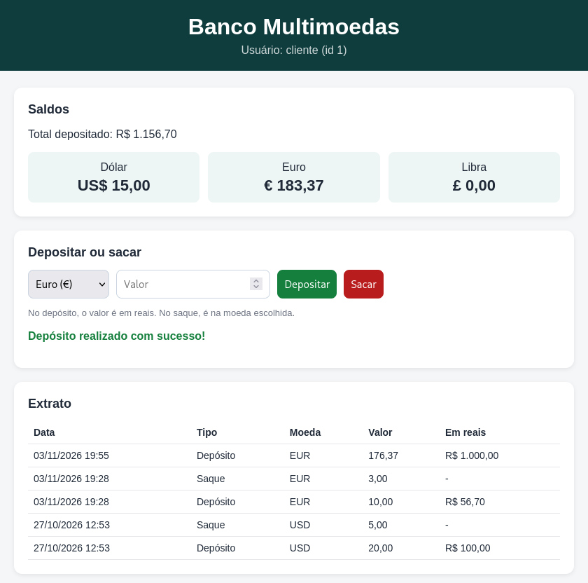

# 🏦 Banco Multimoedas


Sistema bancário **Full Stack** feito com **Python (Flask)**, **PostgreSQL** e **HTML, CSS e JavaScript**. O usuário deposita reais e converte para **dólar, euro ou libra**, consulta saldos, faz saques e vê o extrato, tudo por uma página web que conversa com uma API própria. Os dados ficam salvos no banco, então nada se perde ao fechar o programa.

O projeto começou como um programa de terminal (que continua disponível) e evoluiu para a versão web.

---

## 🖥️ Demonstração

### Versão web



### Versão terminal

```
===== LOGIN - BANCO MULTIMOEDAS =====
(digite 'novo' para criar uma conta ou 'sair' para fechar)
Usuário: deivid
Senha:

Login realizado! Bem-vindo, deivid.

===== BANCO MULTIMOEDAS =====
Usuário: deivid
1 - Depositar e converter
2 - Consultar saldos
3 - Sacar
4 - Extrato
0 - Sair da conta
Escolha uma opção: 1
Valor do depósito em reais: R$ 100

Escolha a moeda:
1 - Dólar
2 - Euro
3 - Libra
Moeda: 1
Você recebeu US$ 20.00
Depósito realizado com sucesso!
```

---

## ✨ Funcionalidades

- **Interface web** com saldos, depósito, saque e extrato, atualizados na hora sem recarregar a página
- **API REST em Flask** que o front-end consome via `fetch`
- **Cadastro de usuários** direto na tela de login
- **Login seguro** — senha oculta ao digitar, armazenada com hash (PBKDF2) e bloqueio após 3 tentativas
- **Depósito com conversão** de reais para Dólar, Euro ou Libra
- **Consulta de saldos** em todas as moedas
- **Saque** com verificação de saldo feita pelo próprio banco
- **Extrato** com histórico de todas as operações
- **Dados persistentes** no PostgreSQL
- **Validação de entradas** — aceita vírgula (`10,50`), recusa valores negativos ou zero e não quebra com texto inválido

---

## 🔒 Destaques técnicos

- **Transações** — cada operação é "tudo ou nada", então o saldo nunca fica inconsistente
- **Proteção contra SQL Injection** com consultas parametrizadas
- **`Decimal` e `NUMERIC`** para valores monetários, evitando erros de arredondamento
- **Restrições no banco** (`CHECK`, chaves estrangeiras) que impedem saldo negativo e dados inválidos
- **Separação de responsabilidades** — interface, acesso a dados e conexão em arquivos diferentes
- **Credenciais fora do código** com variáveis de ambiente (`.env`)

---

## 🔌 API

| Método | Rota | O que faz |
| ------ | ---- | --------- |
| GET | `/` | Página web |
| GET | `/moedas` | Lista as moedas e cotações |
| GET | `/saldos/<id>` | Saldo em cada moeda e total depositado |
| GET | `/extrato/<id>` | Histórico de depósitos e saques |
| POST | `/depositar/<id>` | Deposita reais e converte (`{"moeda": "EUR", "valor": 100}`) |
| POST | `/sacar/<id>` | Saca da moeda escolhida (`{"moeda": "EUR", "valor": 10}`) |

As rotas POST validam a moeda e o valor e respondem com erro `400` quando algo está errado (moeda inválida, valor negativo ou saldo insuficiente).

---

## 🧩 Estrutura

```
banco-multimoedas/
├── app.py             # API em Flask (back-end web)
├── templates/
│   └── index.html     # página web: HTML, CSS e JavaScript
├── conversor.py       # versão terminal: menus e entrada do usuário
├── repositorio.py     # operações no banco de dados (usado pelas duas versões)
├── db.py              # conexão com o PostgreSQL
├── sql/schema.sql     # criação das tabelas
├── .env.example       # modelo das variáveis de ambiente
└── requirements.txt
```

O banco tem quatro tabelas: `usuarios`, `moedas`, `saldos` e `movimentacoes` (que alimenta o extrato).

---

## 🚀 Como rodar

Precisa ter **Python 3** e **PostgreSQL** instalados.

```bash
git clone https://github.com/deividazevedo292-coder/banco-multimoedas.git
cd banco-multimoedas

python3 -m venv .venv
source .venv/bin/activate
pip install -r requirements.txt

psql -h localhost -U postgres -c "CREATE DATABASE banco_multimoedas;"
psql -h localhost -U postgres -d banco_multimoedas -f sql/schema.sql

cp .env.example .env    # depois edite o .env com a sua senha do PostgreSQL
```

**Versão web:**

```bash
python app.py
```

Depois abra **http://127.0.0.1:5000** no navegador.

> Por enquanto a versão web usa a conta de id 1. Crie uma conta pela versão terminal antes de abrir a página. O login pela web é o próximo passo do projeto.

**Versão terminal:**

```bash
python conversor.py
```

Na tela de login, digite `novo` para criar uma conta.

> 💡 Rode pelo terminal. A senha oculta (`getpass`) pode não funcionar no console de depuração de algumas IDEs.

### Cotações

Ficam na tabela `moedas` (valor de 1 unidade em reais):

| Moeda | Cotação |
| ----- | ------- |
| Dólar | R$ 5,00 |
| Euro  | R$ 5,67 |
| Libra | R$ 6,67 |

---

## 📚 O que pratiquei

- Modelagem de banco de dados relacional e SQL (`JOIN`, `UPSERT`, restrições)
- Integração Python + PostgreSQL com `psycopg2`
- Segurança básica: hash de senhas, consultas parametrizadas e `.env`
- Organização do código em camadas (interface × dados), o que permitiu criar a versão web reaproveitando toda a lógica do banco
- Criação de uma API REST com Flask (rotas GET e POST, JSON e códigos de status HTTP)
- Front-end com HTML, CSS e JavaScript consumindo a API com `fetch`
- Tratamento de erros com `try/except` e validação de entradas

---

## 🛣️ Próximos passos

- [x] Cadastro de novos usuários
- [x] Extrato com histórico de operações
- [x] Salvar os dados de forma persistente (PostgreSQL)
- [x] Guardar as senhas com hash
- [ ] Buscar cotações reais pela internet (API do Banco Central)
- [ ] Conversão direta entre moedas estrangeiras
- [x] Interface web
- [ ] Login e cadastro pela interface web

> 📊 Veja também: **[Análise de Câmbio](https://github.com/deividazevedo292-coder/analise-cambio)** — projeto complementar que analisa o histórico real das cotações com dados do Banco Central, com [dashboard online](https://dashboard-cambio-deivid.streamlit.app).

---

## 🛠️ Tecnologias

- Python 3 e Flask
- PostgreSQL
- psycopg2
- python-dotenv
- HTML, CSS e JavaScript

---

## 👤 Autor

**Deivid Azevedo Dantas** — estudante de Análise e Desenvolvimento de Sistemas na FMU

[](https://www.linkedin.com/in/deivid-azevedo-4b5709344/)
[](https://deividazevedo292-coder.github.io/)
