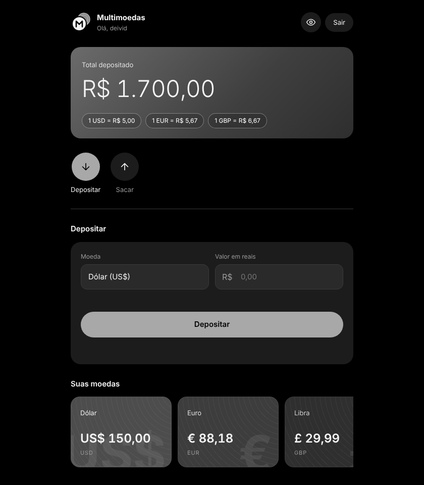

<p align="center">
  
</p>

<h1 align="center">Banco Multimoedas</h1>

<p align="center">
  Banco digital Full Stack para guardar reais e converter para dólar, euro e libra.
</p>

<p align="center">
  <a href="https://banco-multimoedas.onrender.com"><strong>Acessar o site</strong></a>
</p>

<p align="center">
  
</p>

<p align="center"><sub>Tela principal (valores de exemplo)</sub></p>

---

## Sobre o projeto

O Banco Multimoedas começou como um conversor de moedas em Python no terminal e evoluiu para uma aplicação web completa. Cada pessoa cria sua conta, faz login e movimenta os próprios saldos em várias moedas, com extrato de tudo o que fez.

> O site usa o plano gratuito do Render, então pode levar cerca de 1 minuto para abrir no primeiro acesso.

## Funcionalidades

- Cadastro e login de usuários, com senha protegida por hash
- Depósito em reais com conversão automática para dólar, euro ou libra
- Saque na moeda escolhida, com verificação de saldo
- Saldo de cada moeda e total depositado em reais
- Extrato com todas as movimentações
- Prévia da conversão enquanto o valor é digitado
- Botão para esconder os valores da tela
- Layout responsivo, que funciona no celular

## Tecnologias

| Camada | Tecnologia |
|---|---|
| Back-end | Python, Flask |
| Banco de dados | PostgreSQL (Neon) |
| Front-end | HTML, CSS, JavaScript |
| Deploy | Render, com Gunicorn |

## Destaques técnicos

- **Senhas seguras:** as senhas nunca são salvas em texto puro. Cada uma recebe um sal aleatório e é transformada com PBKDF2-SHA256.
- **Usuário vem da sessão, não da URL:** as rotas da API (`/saldos`, `/extrato`, `/depositar`, `/sacar`) pegam o id de quem está logado na sessão do Flask. Assim, ninguém consegue ver ou mexer na conta de outra pessoa trocando um número no endereço.
- **Código organizado em camadas:** o `app.py` cuida das rotas, o `repositorio.py` concentra o acesso ao banco e o `db.py` cuida da conexão.
- **Integridade no banco:** chaves estrangeiras e regras `CHECK` impedem saldo negativo, cotação zerada e tipos de movimentação inválidos.
- **Configuração por variáveis de ambiente:** a senha do banco e a chave secreta ficam fora do código, então o mesmo projeto roda no computador e na nuvem.

## Como rodar no seu computador

Você vai precisar de Python 3 e de um PostgreSQL rodando.

```bash
# 1. Clone o repositório
git clone https://github.com/deividazevedo292-coder/banco-multimoedas.git
cd banco-multimoedas

# 2. Crie e ative um ambiente virtual
python -m venv .venv
source .venv/bin/activate   # no Windows: .venv\Scripts\activate

# 3. Instale as dependências
pip install -r requirements.txt

# 4. Configure o banco: copie o exemplo e preencha com os seus dados
cp .env.example .env

# 5. Crie as tabelas rodando o sql/schema.sql no seu PostgreSQL

# 6. Rode o projeto
python app.py
```

Depois, abra `http://127.0.0.1:5000` no navegador.

## Estrutura do projeto

```
banco-multimoedas/
├── app.py            # rotas da API e das páginas (Flask)
├── repositorio.py    # funções que conversam com o banco de dados
├── db.py             # conexão com o PostgreSQL
├── conversor.py      # versão original, no terminal
├── sql/
│   └── schema.sql    # criação das tabelas e moedas iniciais
├── templates/
│   ├── index.html    # tela principal do banco
│   ├── login.html
│   └── cadastro.html
└── requirements.txt
```

## Próximos passos

- Atualizar as cotações automaticamente pela API do Banco Central
- Transferência entre contas
- Testes automatizados

## Autor

**Deivid Azevedo Dantas**, estudante de Análise e Desenvolvimento de Sistemas no Centro Universitário FMU.

- Portfólio: [deividazevedo292-coder.github.io](https://deividazevedo292-coder.github.io/)
- LinkedIn: [Deivid Azevedo](https://www.linkedin.com/in/deivid-azevedo-4b5709344/)
- GitHub: [deividazevedo292-coder](https://github.com/deividazevedo292-coder)
